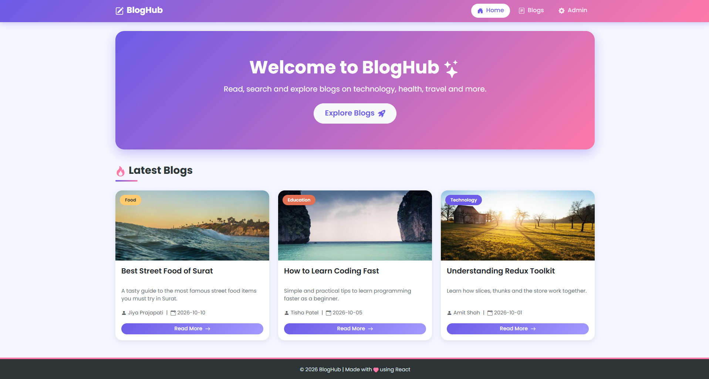
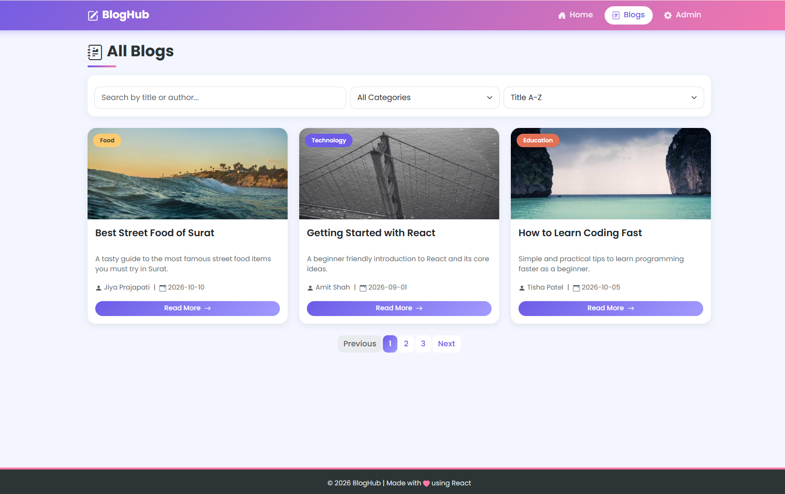
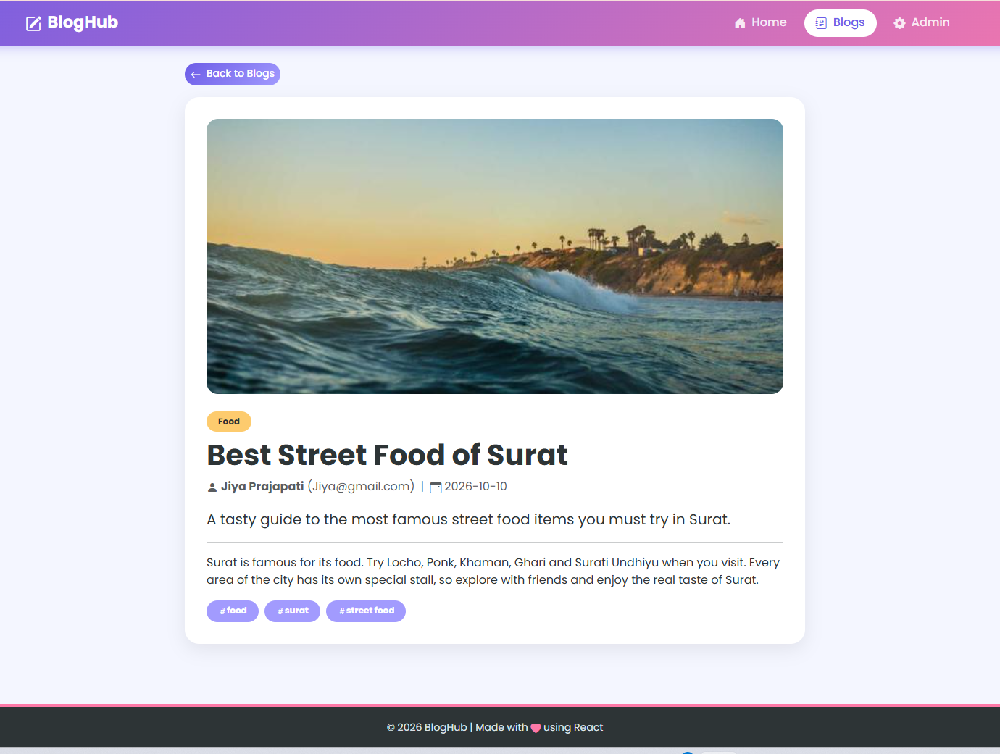
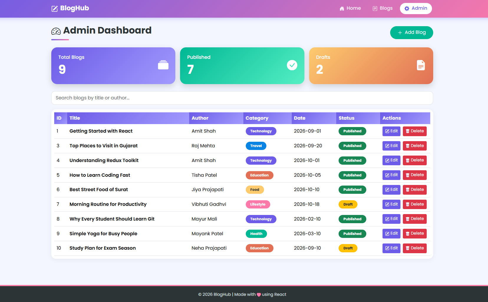

# 💻 Blog Management System

## 📝 Project Description

The **Blog Management System** is a React-based web application designed to manage blog posts efficiently. Users can view blogs, search by title or author, filter blogs by category, and sort them by date or alphabetically.

The admin section allows administrators to add, edit, and delete blog posts. The application uses Redux Toolkit for state management, Axios for API integration, and JSON Server as a backend.

This project demonstrates the practical implementation of React.js, reusable components, React Router, CRUD operations, API integration, searching, filtering, and sorting.

---

## ✨ Features

### 👤 User Side

- View all available blogs.
- Search blogs by title or author.
- Filter blogs by category.
- Sort blogs by latest and oldest dates.
- Sort blog titles alphabetically (A–Z and Z–A).
- View individual blog details.

### 🔐 Admin Side

- Admin dashboard.
- Add new blog posts.
- Edit existing blog posts.
- Delete blog posts.
- Manage blog records using CRUD operations.

### ⚙️ Technical Features

- React.js-based application.
- Reusable React components.
- React Router navigation.
- Redux Toolkit state management.
- Axios API integration.
- JSON Server backend.
- Search and category filtering.
- Date sorting and alphabetical sorting.
- Responsive user interface.

---

## 🛠️ Technologies Used

| Technology | Purpose |
|---|---|
| React.js | Frontend development |
| JavaScript | Application functionality |
| HTML5 | Web page structure |
| CSS3 | Styling and layout |
| React Router DOM | Page navigation |
| Redux Toolkit | State management |
| React Redux | Connecting React with Redux |
| Axios | API requests |
| JSON Server | Mock REST API backend |
| Vite | Development server and build tool |
| npm | Package management |

---

## 🧱 Project Structure

```text
blog-management-system/
│
├── public/
│   ├── favicon.svg
│   └── icons.svg
│
├── Screenshoot/
│   ├── Admin-dashboard.png
│   ├── Blog-Details.png
│   ├── Blogs.png
│   └── Home-page.png
│
├── src/
│   ├── assets/
│   │   ├── hero.png
│   │   ├── react.svg
│   │   └── vite.svg
│   │
│   ├── components/
│   │   ├── BlogCard.jsx
│   │   ├── BlogForm.jsx
│   │   ├── Footer.jsx
│   │   ├── Header.jsx
│   │   ├── Pagination.jsx
│   │   └── SearchBar.jsx
│   │
│   ├── Pages/
│   │   ├── admin/
│   │   │   ├── AddBlog.jsx
│   │   │   ├── Dashboard.jsx
│   │   │   └── EditBlog.jsx
│   │   │
│   │   ├── BlogDetails.jsx
│   │   ├── Blogs.jsx
│   │   └── Home.jsx
│   │
│   ├── redux/
│   │   ├── blogSlice.js
│   │   └── store.js
│   │
│   ├── App.css
│   ├── App.jsx
│   ├── constants.js
│   ├── index.css
│   └── main.jsx
│
├── Code-explanation video.mp4
├── db.json
├── eslint.config.js
├── index.html
├── package.json
├── package-lock.json
├── README.md
├── vite.config.js
└── .gitignore
```

*Note: The structure above documents the project files and folders. If any filename differs in your local ZIP, use the exact filename from your project.*

---

## 📂 Folder and File Description

- **public/** – Contains public assets and icons.
- **Screenshoot/** – Contains screenshots of the application's main pages.
- **src/assets/** – Contains images and other assets used in the application.
- **src/components/** – Contains reusable React components.
- **src/Pages/** – Contains the Home, Blogs, and Blog Details pages.
- **src/Pages/admin/** – Contains admin dashboard, add blog, and edit blog pages.
- **src/redux/** – Contains the Redux Toolkit store and blog slice.
- **App.jsx** – Main application component.
- **main.jsx** – Entry point of the React application.
- **App.css** – Application-specific styles.
- **index.css** – Global styles.
- **constants.js** – Contains application constants.
- **db.json** – Stores blog data used by JSON Server.
- **package.json** – Contains project dependencies and npm scripts.
- **package-lock.json** – Records the resolved npm dependency versions.
- **vite.config.js** – Contains Vite configuration.
- **eslint.config.js** – Contains ESLint configuration.
- **Code-explanation video.mp4** – Project code explanation video.

---

## ⚙️ Installation and Setup

Follow these steps to run the project locally.

### Step 1: Download or Extract the Project

Extract the project ZIP file and open the `blog-management-system` folder in Visual Studio Code.

### Step 2: Open the Terminal

Open the VS Code terminal inside the project root folder.

### Step 3: Install Dependencies

Run the following command:

```bash
npm install
```

### Step 4: Start JSON Server

If the project uses JSON Server on port 3000, run:

```bash
npx json-server --watch db.json --port 3000
```

Keep this terminal running.

### Step 5: Start the React Application

Open another terminal in the same project folder and run:

```bash
npm run dev
```

### Step 6: Open the Website

Open the local URL displayed in the terminal. The default Vite development URL is usually:

```text
http://localhost:5173
```

**Important:** Check `package.json` for the available npm scripts and `src/constants.js` or the relevant API configuration for the JSON Server URL and port. If JSON Server is already configured in an npm script, use the existing script.

---

## 🔄 CRUD Operations

CRUD stands for Create, Read, Update, and Delete.

| Operation | Description |
|---|---|
| Create | Add a new blog post |
| Read | Display existing blog posts |
| Update | Edit an existing blog post |
| Delete | Remove an existing blog post |

These operations allow the application to manage blog records through the backend API.

---

## 🔍 Search, Filter, and Sort

### Search Functionality

Users can search for blog posts using the blog title or author name.

### Category Filtering

Users can filter blog posts according to their category.

### Date Sorting

Users can arrange blog posts by latest or oldest date.

### Alphabetical Sorting

Users can sort blog titles in ascending (A–Z) or descending (Z–A) order.

---

## 📸 Screenshots

The following screenshots demonstrate the main pages and features of the Blog Management System.

### 1. Home Page

The Home Page provides the main interface for users to explore the website.



### 2. Blogs Page

The Blogs Page displays available blog posts and provides access to blog-related features.



### 3. Blog Details Page

The Blog Details Page displays the information for an individual blog post.



### 4. Admin Dashboard

The Admin Dashboard provides the interface for managing blog posts.




## 🎥 Code Explanation Video

The code explanation video explains the project structure, React components, state management, API integration, and CRUD operations.

[▶️ Watch Project Code Explanation Video](https://drive.google.com/file/d/1eYCbm9LLa1fM3DOqKdQ_8KMUP6Rsc5Df/view?usp=sharing)

### How to Add Google Drive Links

1. Upload your video to Google Drive.
2. Right-click the uploaded video and select **Share**.
3. Under General access, select **Anyone with the link**.
4. Set the permission to **Viewer**.
5. Click **Copy link**.
6. Replace the corresponding placeholder in this README with the copied URL.

The project contains `Code-explanation video.mp4`, which can be uploaded to Google Drive and linked above. Add a separate demo link if you have recorded a project demonstration.

---

## 📚 Learning Outcomes

Through this project, I learned:

- How to develop a web application using React.js.
- How to create reusable React components.
- How to manage application state using Redux Toolkit.
- How to navigate between pages using React Router.
- How to integrate APIs using Axios.
- How to perform CRUD operations.
- How to connect a React frontend with JSON Server.
- How to implement search, filtering, and sorting.
- How to organize a React project structure.
- How to document a project using Markdown.

---

## 🔮 Future Improvements

- User authentication and authorization.
- Blog comments and likes.
- Blog image upload functionality.
- Improved pagination.
- Enhanced responsive design.
- Advanced admin dashboard features.

---

## 👨‍💻 Author

**Name:** Your Name

**Project Title:** Blog Management System

**Frontend:** React.js

**Backend:** JSON Server

---

## 📄 License

This project was developed for educational and learning purposes.
